class: black-slide
background-image: url(figures/title-bg.jpg)
background-size: cover

.overlay-box.overlay-title-slide[
.overlay-title[Simulation-based inference for exoplanets]

.title-author[.title-author-text[Gilles Louppe .smaller[[g.louppe@uliege.be](mailto:g.louppe@uliege.be)]]]

.title-author[.title-author-text[Max Dax .smaller[[maximilian.dax@tuebingen.mpg.de](mailto:maximilian.dax@tuebingen.mpg.de)]]]

.title-footer[.smaller[Exomints 2026 November 10, 2026]]
]

.footnote[Illustration of WASP-39 b: NASA, ESA, CSA, J. Olmsted (STScI).]

???

Thank you for having us.

One idea for this tutorial: if you can simulate a spectrum, you can infer the parameters that produced it, without the likelihood.

---

class: black-slide
background-image: url(figures/ocean-x.jpg)
background-size: cover

.overlay-box.overlay-top-left[
.overlay-title[Ocean currents]

.italic[Observations:] the height $x$ of the sea surface, measured coarsely by satellite altimeters, along their tracks.
]

.footnote[Sea surface height anomaly, Gulf Stream off North Carolina, January 21, 2023, from 7 altimeters. Credit: NASA/JPL-Caltech/Copernicus Marine Service ([PIA25773](https://science.nasa.gov/photojournal/sea-level-visualization-of-gulf-stream)).]

???

Let us start with the ocean. From orbit, satellites do not see currents. Altimeters measure the height of the sea surface, along their tracks, at a resolution of tens of kilometres. Here, the Gulf Stream off North Carolina: red is higher than average, blue lower. This is $x$.

---

class: black-slide

.bg-video[<video autoplay muted loop playsinline poster="figures/ocean-z-poster.jpg" src="figures/videos/ocean-z.mp4"></video>]

.overlay-box.overlay-top-left[
.overlay-title[Ocean currents]

.italic[Latent states:] the currents $z$ that shape the surface, the Gulf Stream, its jets and eddies.
]

.footnote[Perpetual Ocean, ECCO2 model. Visualization: NASA/Goddard Space Flight Center Scientific Visualization Studio ([SVS 3827](https://svs.gsfc.nasa.gov/3827)).]

???

What shapes the surface are the currents: the Gulf Stream, its meanders, its eddies. This is $z$. Many states of the ocean fit the same coarse heights, so we want all of them, as a distribution.

---

class: black-slide

.bg-video[<video autoplay muted loop playsinline poster="figures/ocean-theta-poster.jpg" src="figures/videos/ocean-theta.mp4"></video>]

.overlay-box.overlay-top-left[
.overlay-title[Ocean currents]

.italic[Parameters:] the global constants $\theta$ of the ocean model, such as its viscosity $\nu$. Same equations, different values, different oceans.
]

.footnote[Illustration: 2D turbulence on a $\beta$-plane, same forcing, three viscosities; current speed.]

???

The currents obey known equations, the Navier–Stokes equations on a rotating Earth. These equations have constants that we do not know well: the viscosity, the mixing, the drag on the sea floor. These are $\theta$. Here, the same equations, the same forcing, with three values of the viscosity. Smooth, turbulent, filamented. Often, these constants are what we want.

The same question comes up whenever an instrument stands between us and what we study. Two more examples.

---

class: black-slide

.bg-video[<video autoplay muted loop playsinline poster="figures/gw-x-poster.jpg?v=2" src="figures/videos/gw-x.mp4?v=2"></video>]

.overlay-box.overlay-top-left[
.overlay-title[Gravitational waves]

.italic[Observations:] the strain $x$ recorded by LIGO. In time and frequency, a chirp rises out of the noise.
]

.footnote[Data: LIGO Hanford, GW150914, September 14, 2015 ([GWOSC](https://gwosc.org/events/GW150914/)). Whitened strain, band-passed 35–350 Hz (white), and its wavelet transform, 20–512 Hz.]

???

Second, gravitational waves. On September 14, 2015, the LIGO detectors recorded this. Time goes to the right, frequency goes up. In white, the strain itself, as usually shown. Most of it is noise. Then, in a fraction of a second, a chirp: a signal whose frequency rises quickly. This is $x$.

---

class: black-slide

.bg-video[<video autoplay muted loop playsinline poster="figures/gw-z-poster.jpg" src="figures/videos/gw-z.mp4"></video>]

.overlay-box.overlay-top-left[
.overlay-title[Gravitational waves]

.italic[Latent states:] the signal $z$ of two black holes that spiral into each other, merge, and ripple space-time.
]

.footnote[Simulation: B. J. Kelly, C. Henze, T. Sandstrom, [NASA SVS 13197](https://svs.gsfc.nasa.gov/13197).]

???

The chirp comes from two black holes that spiral into each other and merge. General relativity predicts the waveform. This is $z$.

---

class: black-slide
background-image: url(figures/gw-theta.jpg)
background-size: cover

.overlay-box.overlay-top-left[
.overlay-title[Gravitational waves]

.italic[Parameters:] the properties $\theta$ of the binary, masses, spins, distance, orientation, sky position (15 in total).
]

.footnote[Illustration: LIGO/Caltech/MIT/Sonoma State (Aurore Simonnet).]

???

The waveform depends on the parameters of the binary: two masses, two spins, which can tilt, the distance, the orientation, the position on the sky. Fifteen parameters. This is $\theta$.

---

class: black-slide

.bg-video[<video autoplay muted loop playsinline poster="figures/exo-x-poster.jpg" src="figures/videos/exo-x.mp4"></video>]

.overlay-box.overlay-top-right.exo-spectrum[
]

.overlay-box.overlay-intro[
.overlay-title[Exoplanets]

.italic[Observations:] the spectrum $x$ of a planet, whose light direct imaging separates from its star.
]

.footnote[HR 8799, Keck, 2009–2016: Jason Wang (Caltech), Christian Marois (NRC Herzberg), [CC BY 3.0](https://creativecommons.org/licenses/by/3.0/). Spectrum: simulated benchmark of [Vasist et al](https://arxiv.org/abs/2301.06575), A&A 2023.]

???

Third, exoplanets. These are four planets orbiting the star HR 8799, imaged directly over seven years. The star is masked. Each dot is the light of a planet. Spread with a spectrograph, it gives a spectrum, like this one, from 1 to 2.5 microns. This is $x$.

---

class: black-slide
background-image: url(figures/exo-z.jpg?v=6)
background-size: cover

.overlay-box.overlay-intro[
.overlay-title[Exoplanets]

.italic[Latent states:] the atmosphere $z$, its temperature profile, its molecules, its clouds.
]

.footnote[VHS 1256 b. Illustration: NASA, ESA, CSA, Joseph Olmsted (STScI).]

???

The spectrum comes from the atmosphere: how temperature changes with depth, which molecules are there, where the clouds are. Here, the clouds of silicate dust seen by Webb on VHS 1256 b. This is $z$.

---

class: black-slide
background-image: url(figures/exo-theta.jpg?v=2)
background-size: cover

.overlay-box.overlay-intro[
.overlay-title[Exoplanets]

.italic[Parameters:] the bulk properties $\theta$, C/O, metallicity, gravity, radius, clouds, mixing. Different values, different atmospheres.
]

.footnote[Ten hot Jupiters studied with Hubble ([Sing et al](https://doi.org/10.1038/nature16068), Nature 2016). Illustration: ESA/Hubble & NASA.]

???

The atmosphere follows from a few parameters: the C/O ratio, the metallicity, gravity, radius, clouds, mixing. Change them, and you get a different atmosphere: these ten hot Jupiters range from clear to cloudy. The parameters also tell us where and how the planet formed. This is $\theta$.

---

class: middle

.center.width-80[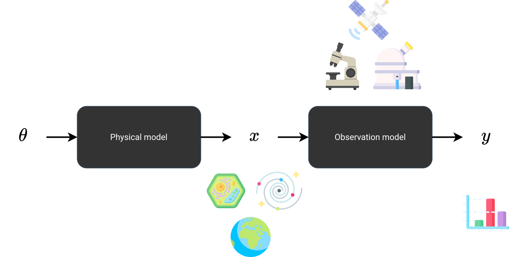]

## Inverse problems in science

Given an observation $x$, estimate the posterior distribution
$$p(\theta | x) = \frac{p(x|\theta) p(\theta)}{p(x)}, \quad \text{with} \quad p(x | \theta) = \int p(x | z) p(z | \theta) \text{d}z,$$
of the parameters $\theta$, with the latent states $z$ integrated out.

???

All three examples have the same structure. Parameters $\theta$ set the physics. The physics produces a state $z$. An instrument turns $z$ into an observation $x$.

We want to go back to $\theta$, as a distribution: the posterior. The catch is the likelihood. To evaluate it, we must integrate over every state $z$ that could have produced $x$. We can simulate this chain, but we cannot evaluate it.

---

class: middle

.grid[
.kol-1-4[&nbsp;]
.kol-3-4[.flow.flow-right[Generation]]
]

.grid[
.kol-1-4[&nbsp;]
.kol-1-4[.center[.icons[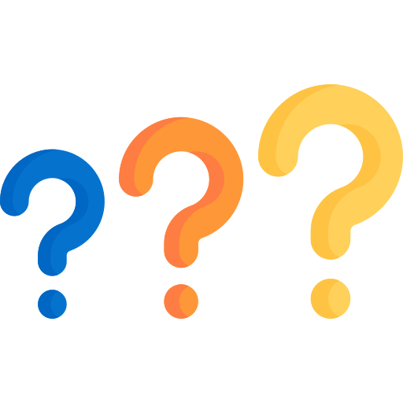] .bold[Prior] $p(\theta)$]]
.kol-1-4[.center[.icons[] .bold[Physics] $p(z | \theta)$]]
.kol-1-4[.center[.icons[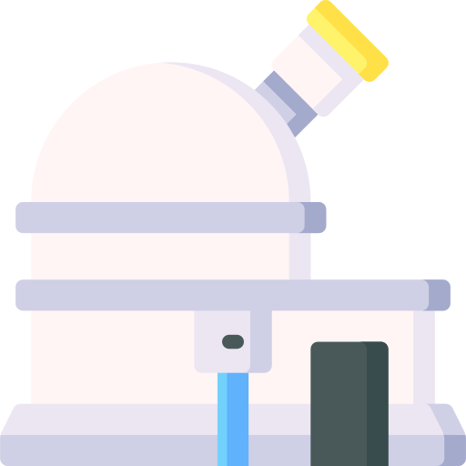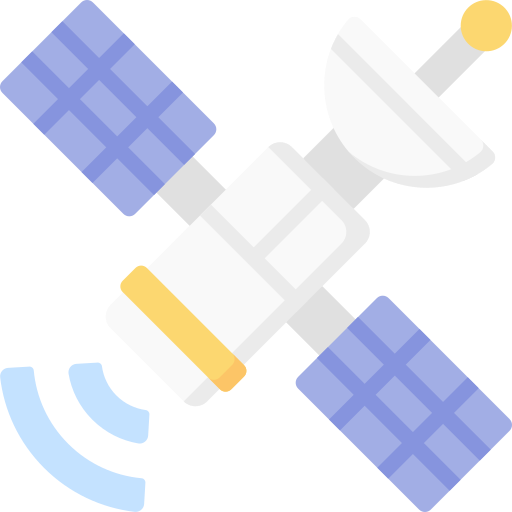] .bold[Instrument] $p(x | z)$]]
]

.recipe[
.grid[
.kol-1-4[.italic[Ocean currents]]
.kol-1-4[.center[viscosity, mixing, drag]]
.kol-1-4[.center[Navier–Stokes]]
.kol-1-4[.center[altimetry, noise]]
]
.grid[
.kol-1-4[.italic[Gravitational waves]]
.kol-1-4[.center[masses, spins, distance]]
.kol-1-4[.center[general relativity]]
.kol-1-4[.center[detector response, noise]]
]
.grid[
.kol-1-4[.italic[Exoplanets]]
.kol-1-4[.center[C/O, metallicity, clouds]]
.kol-1-4[.center[radiative transfer]]
.kol-1-4[.center[spectrograph, noise]]
]
]

.grid[
.kol-1-4[&nbsp;]
.kol-3-4[.flow.flow-left[Inference]]
]

???

Generation goes left to right: draw parameters from the prior, run the physics, then the instrument. Each step is a simulator we trust.

Inference goes right to left. From $x$ back to $\theta$.

---

class: middle

## A minimal exoplanet simulator

Prior, $\theta \sim p(\theta)$: six numbers, each uniform over a range.

.center[
<video poster="figures/toy-walk-1.png" muted loop autoplay playsinline class="anim">
<source src="figures/videos/toy-walk-1.mp4" type="video/mp4">
</video>
]

???

Let me make this concrete with a small simulator, which I will use for the rest of the tutorial. It is a toy, but it has the same structure as a real retrieval code.

We start from six parameters: the internal temperature, the gravity, the metallicity, the C/O ratio, the pressure at the top of the clouds, and the radius. The prior draws them uniformly within ranges.

---

class: middle

## A minimal exoplanet simulator

Physics, $z \sim p(z | \theta)$: a temperature profile, chemistry, and a cloud deck.

.center[
<video poster="figures/toy-walk-2.png" muted loop autoplay playsinline class="anim">
<source src="figures/videos/toy-walk-2.mp4" type="video/mp4">
</video>
]

???

From the parameters, the physics gives the atmosphere. Here, a temperature profile, the abundances of water, methane and carbon monoxide along it, and a cloud deck. This is $z$. Watch methane: it appears where the atmosphere is cool enough.

As in retrieval codes such as petitRADTRANS, the profile is parameterized, not self-consistent: a grey Eddington profile set by the internal temperature and the gravity. The chemistry follows a fixed rule of temperature, pressure, metallicity and C/O, and the clouds are a deck with a parameterized top.

---

class: middle

## A minimal exoplanet simulator

Radiative transfer: the light $f(\theta)$ that the atmosphere emits.

.center[
<video poster="figures/toy-walk-3.png" muted loop autoplay playsinline class="anim">
<source src="figures/videos/toy-walk-3.mp4" type="video/mp4">
</video>
]

???

Then, radiative transfer. Light escapes from the atmosphere, except where molecules absorb it. The dips are water and methane bands. The peaks are windows into deeper, hotter layers.

---

class: middle

## A minimal exoplanet simulator

Instrument, $x \sim p(x | z)$: binned, with noise. This is all we observe.

.center[
<video poster="figures/toy-walk-4.png" muted loop autoplay playsinline class="anim">
<source src="figures/videos/toy-walk-4.mp4" type="video/mp4">
</video>
]

???

Finally, the instrument. It bins the light and adds noise. This is $x$, and it is all we get. Everything to its left is hidden.

That is the simulator: draw $\theta$, compute $z$, compute $f$, add noise. Easy to run forward. The question is how to go back.

---

class: middle

## Prior predictive check

Before seeing any data, we check the .bold[forward model] against domain knowledge: we draw $\theta \sim p(\theta)$, simulate, and compare summary statistics with known objects.

.center[
<video poster="figures/toy-prior-pc.png?v=3" muted loop autoplay playsinline class="anim">
<source src="figures/videos/toy-prior-pc.mp4?v=3" type="video/mp4">
</video>
]

???

We check the prior and the simulator together, before any data. We draw parameters from the prior and simulate. Spectra are hard to judge by eye, so we reduce each one to a summary statistic measured on other objects: here, the J − K colour. Known brown dwarfs and directly imaged planets lie roughly between −1 and 3.

Our toy fails: 42% of the prior draws are redder than any known object. The prior is too broad, the physics too crude, or both. In a real analysis, we would revise one of them here. Band depths or the total flux serve the same purpose.

The check uses domain knowledge, not the observation. Tuning the prior to the data under analysis would use the data twice.

The check costs nothing: these simulations are the training set of neural posterior estimation.

---

class: black-slide

.bg-video[<video autoplay muted loop playsinline poster="figures/galaxy-1.jpg?v=6" src="figures/videos/galaxy-1.mp4?v=6"></video>]

.overlay-box.overlay-bottom-left.narrow-box[
.overlay-title[Inference algorithms]

Estimating $p(\theta | x)$: classical methods in blue, simulation-based inference in pink.
]

???

How do we go back from $x$ to $\theta$? There are many algorithms. In blue, the ones you know: MCMC, nested sampling, and approximate Bayesian computation. In pink, simulation-based inference with neural networks: estimating the posterior, the likelihood, or the likelihood ratio. There are many more of them than the usual suspects, and the list keeps growing.

---

count: false
class: black-slide

.bg-video[<video autoplay muted playsinline poster="figures/galaxy-2.jpg?v=6" src="figures/videos/galaxy-2.mp4?v=6"></video>]

.overlay-box.overlay-bottom-left.narrow-box[
.overlay-title[Inference algorithms]

Estimating $p(\theta | x)$: classical methods in blue, simulation-based inference in pink.
]

???

Today, we focus on two of them: neural posterior estimation, NPE, and its flow-matching variant, FMPE. NPE is the simplest, and the one used in most exoplanet retrievals with SBI so far.

---

class: middle

## Neural posterior estimation

We train a conditional density estimator $q\_\phi(\theta | x)$, typically a .bold[normalizing flow], to approximate the posterior of .bold[any] observation $x$,
$$\phi^\star = \arg\min\_\phi \; \mathbb{E}\_{p(\theta, x)} \left[ -\log q\_\phi(\theta | x) \right].$$

The expectation runs over pairs $(\theta, x)$ from the simulator, so that the likelihood is never evaluated.

Up to a constant, this loss is the expected divergence to the true posterior,
$$\mathbb{E}\_{p(x)} \, \text{KL}\big( p(\theta|x) \, \Vert \, q\_\phi(\theta|x) \big).$$

.success[With enough simulations and network capacity, the trained network is the posterior of every observation.]

???

Neural posterior estimation trains a network that takes an observation $x$ and returns a probability distribution over the parameters $\theta$. The output is a whole distribution, not a point estimate. The network is typically a normalizing flow, which we open on the next slide.

We draw pairs of parameters and spectra from the simulator, and we train the network to give high probability to the true parameters given the spectrum. The loss is the negative log-probability of $\theta$ under $q_\phi(\cdot | x)$.

Up to a constant, this loss is the average KL divergence between the true posterior and the network. It is minimized when the network equals the posterior, for every observation. The likelihood is never evaluated; we only run the simulator.

---

class: middle

.center[
<video poster="figures/npe-pipeline.png" muted loop autoplay playsinline class="anim" style="width: 100%;">
<source src="figures/videos/npe-pipeline.mp4" type="video/mp4">
</video>
]

The density is exact, by the change of variables, with $u = t\_3 \circ t\_2 \circ t\_1(\theta)$:
$$\log q\_\phi(\theta | x) = \log \mathcal{N}(u; 0, I) + \sum\_{k=1}^{3} \log \left| \det J\_{t\_k} \right|.$$

???

What does the network look like? Two parts.

First, an embedding network reads the spectrum and compresses it into a few features. It learns which parts of the spectrum matter, instead of hand-crafted summaries.

Second, a normalizing flow. It is a change of variables: an invertible function maps the parameters $\theta$ to a variable $u$ which follows a standard Gaussian. The function is a stack of three spline transforms, and their parameters depend on the features of $x$. Because the map is invertible with a tractable Jacobian, the density of $\theta$ follows from the change of variables formula: the Gaussian density of $u$, times the Jacobian determinant of each transform. In logs, a sum, as written below the figure. That is exactly what the loss needs. And to sample, we draw $u$ from the Gaussian and invert the map.

Under the flow, real samples for our observed spectrum, pushed through the three trained layers: the tilted posterior of the internal temperature and the C/O ratio becomes, step by step, a round Gaussian.

---

class: middle

## Training

We simulate pairs $(\theta\_i, x\_i)$ from the prior and the simulator, and minimize the loss over them, with the noise added on the fly.

.center[
<video poster="figures/toy-training.png" muted loop autoplay playsinline class="anim">
<source src="figures/videos/toy-training.mp4" type="video/mp4">
</video>
]

???

Training requires pairs of parameters and spectra. We draw parameters from the prior and run the simulator. Each line is one simulated planet, coloured by its internal temperature. Hot planets are bright; cool ones are faint, with deep methane bands. We use half a million pairs, simulated in half an hour on a laptop.

With a real code such as petitRADTRANS, one spectrum takes seconds, and twelve million of them took about 17,000 CPU hours. This cost is paid once.

We then minimize the loss by stochastic gradient descent over batches of pairs. The instrument noise is added on the fly, so that each spectrum receives a new noise realization at each epoch. The loss decreases on the training pairs and on pairs held out for validation.

---

class: middle

## Amortization

The network is trained once. Then, any new spectrum gets its posterior in a fraction of a second.

.center[
<video poster="figures/toy-gallery.png?v=3" muted loop autoplay playsinline class="anim">
<source src="figures/videos/toy-gallery.mp4?v=3" type="video/mp4">
</video>
]

???

And this is where NPE shines. The network is trained once, for this simulator and this prior. After that, any new spectrum gets its posterior immediately.

Here, ten new planets: for each, its spectrum, and below, its posterior over the internal temperature and the C/O ratio, with the true value as a star. NPE does all of them in about two seconds. MCMC or nested sampling would take an hour and a half, and much longer with a real radiative transfer code.

Notice that some posteriors are wider than others: the spectrum constrains some planets better than others. The posterior tells us what the data can and cannot constrain.

For a survey of hundreds of planets, this changes what is possible.

---

class: middle

## Results on the toy problem

An observed spectrum $x\_{\rm obs}$, simulated from known parameters $\theta^\star$ (hidden from the methods).

.center.width-100[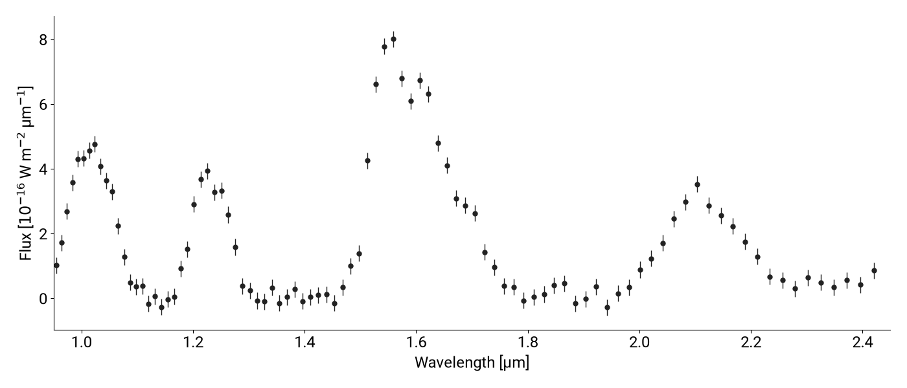]

???

Now, let us use the trained network. Here is an observed spectrum. In this toy problem, we simulated it ourselves, from parameters we know, so we can check the answer. The methods do not know them.

---

class: middle

.center.width-65[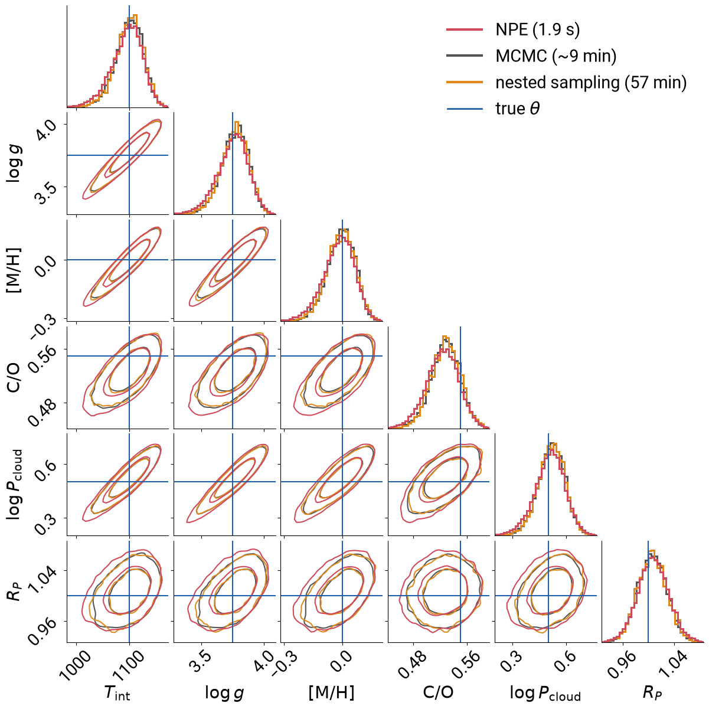]

???

In red, the posterior from NPE. In grey, MCMC, and in orange, nested sampling: in this toy problem, both can use the exact likelihood. The three agree, and contain the true parameters, in blue.

NPE took two seconds. MCMC took nine minutes, nested sampling about an hour. With a real radiative transfer code, they take days, and NPE still takes seconds.

---

class: middle

## Calibration

A posterior is .bold[calibrated] if its 90% credible regions contain the true parameters 90% of the time, and likewise at every level. We check the inference network on $10^3$ simulated observations.

.center[
<video poster="figures/toy-coverage.png" muted loop autoplay playsinline class="anim">
<source src="figures/videos/toy-coverage.mp4" type="video/mp4">
</video>
]

Coverage is necessary but not sufficient, since the prior itself is calibrated. TARP, MIRA and L-C2ST are stronger tests.

.footnote[TARP: [Lemos et al](https://arxiv.org/abs/2302.03026), ICML 2023. MIRA: [Sharief et al](https://arxiv.org/abs/2605.02014), ICML 2026. L-C2ST: [Linhart et al](https://arxiv.org/abs/2306.03580), NeurIPS 2023.]

???

We make two checks, which test two different things. The first tests the inference network, and amortization makes it possible. Posteriors are cheap, so we compute thousands of them for simulated observations whose true parameters we know, and we check that they are calibrated.

On the left, the test cases one by one. For each, we show the 90% credible interval of the C/O ratio and the true value. If the posteriors are calibrated, the true value falls inside 90% of the time. Green marks a hit, red a miss.

On the right, the same question for every credibility level, or expected coverage. As cases accumulate, the curve settles on the diagonal. A curve above the diagonal would indicate conservative posteriors, and below it overconfident ones.

Coverage is necessary but not sufficient, since the prior itself is perfectly calibrated and useless. Stronger tests exist. TARP is necessary and sufficient for the posterior to be correct; MIRA and local tests such as L-C2ST are others, and L-C2ST was used for WISE 1738.

This check took a minute. With MCMC or nested sampling, a thousand retrievals would take a week, which is why such checks are rarely done for retrievals today.

---

class: middle

.avatars[]

Neural posteriors can be .bold[overconfident], even when trained as recommended. Better be overdispersed than overconfident.

.grid[
.kol-1-2[.center.width-100[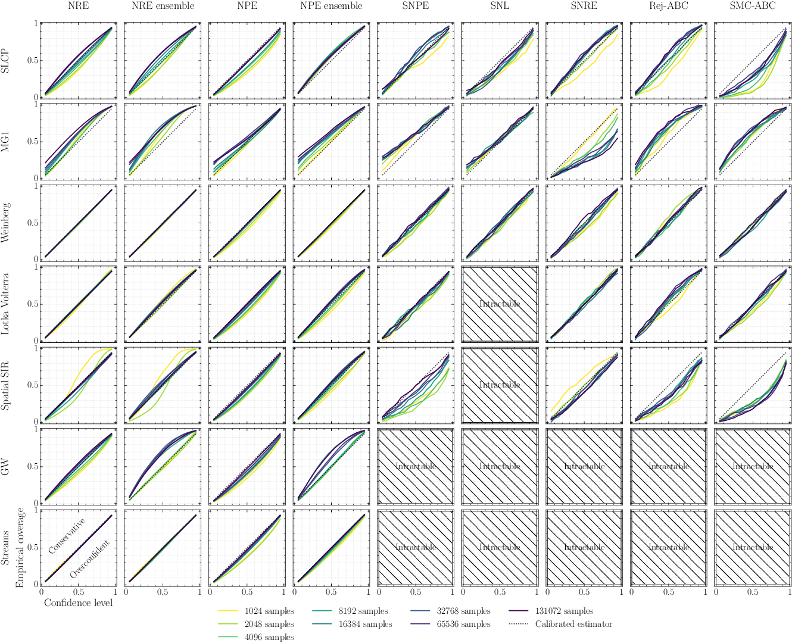]]
.kol-1-2[.center.width-100[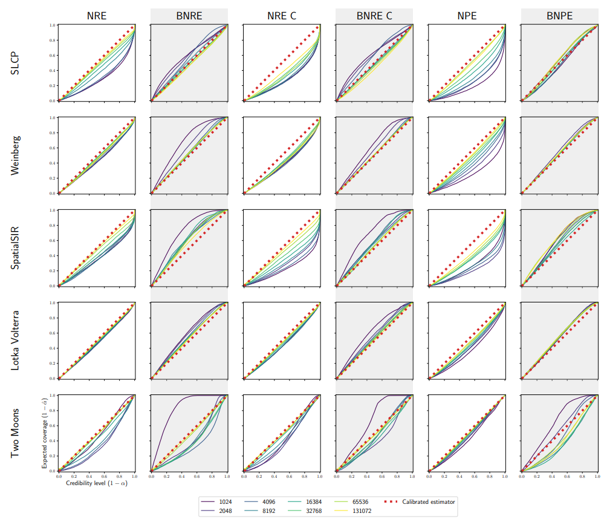]]
]
.grid[
.kol-1-2[.center[Coverage of common SBI algorithms]]
.kol-1-2[.center[Balanced NPE (last column)]]
]

.footnote[[Hermans et al](https://arxiv.org/abs/2110.06581), TMLR 2022. [Delaunoy et al](https://arxiv.org/abs/2304.10978), 2023. See also [Falkiewicz et al](https://arxiv.org/abs/2310.13402), NeurIPS 2023.]

???

Calibration is not a formality. When we benchmarked common SBI algorithms, many of them were overconfident on some problems: their credible regions were too small, curves below the diagonal. Even with the recommended training. For science, an overconfident posterior is the worst outcome: it claims a detection that is not there. Better be overdispersed than overconfident.

One remedy is to ask for conservative posteriors. Balanced NPE adds a regularizer to the loss, which pushes the network towards calibrated or conservative posteriors: the curves move above the diagonal. Another is to directly penalize miscalibration during training.

On our toy problem, we saw the gentler version: a network trained on too few simulations gives posteriors that are too wide. More simulations and training fixed it, and calibration tells us when it is fixed.

---

class: middle

## Posterior predictive check

To check the .bold[forward model], we draw $\theta \sim q\_\phi(\theta | x\_{\rm obs})$, simulate, and compare with the observation.

.center[
<video poster="figures/toy-ppc.png" muted loop autoplay playsinline class="anim">
<source src="figures/videos/toy-ppc.mp4" type="video/mp4">
</video>
]

???

The second check tests the forward model. Calibration uses simulations only, so it cannot tell whether the simulator describes the real planet. The posterior predictive check can, and it is familiar from retrievals. We draw parameters from the posterior, run them through the same simulator, and compare the spectra with the observation. Each draw leaves a trace, and together the traces cover the data within the noise.

---

class: middle

## When the model is wrong

.center.width-100[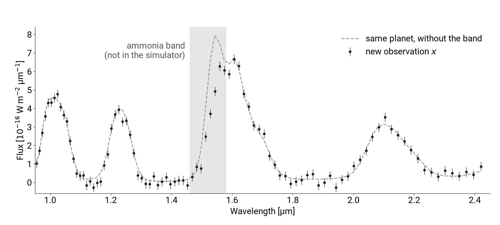]

A new observation of the same planet, with an absorption band at 1.52 μm that the simulator does not have.

???

Every result so far assumed that the simulator is right. Here it is not. Same planet, same noise, but I added an absorption band at 1.52 microns, where ammonia absorbs in cool atmospheres. Our simulator has no ammonia. In dashed grey, what the planet would look like without it.

---

class: middle

.center.width-100[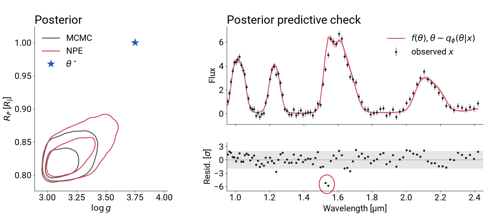]

.center[Both posteriors are .bold[confident and wrong].]

.footnote[Detecting and handling misspecification: [Schmitt et al](https://arxiv.org/abs/2112.08866), 2023; [Ward et al](https://arxiv.org/abs/2210.06564), NeurIPS 2022.]

???

On the left, the posteriors for the gravity and the radius. NPE in red, MCMC in grey. They agree with each other, they are tight, and they both miss the truth, the star. The gravity is even pushed against the edge of the prior, a hint that something is off. MCMC is no safer: it is exact, but for the wrong model. And NPE is now fed a spectrum unlike its training data, so in general it extrapolates without warning. Here it happens to stay close to MCMC.

None of the diagnostics on simulations catch it. Coverage was computed on simulated pairs: the network is still calibrated, for spectra that the simulator can produce. What catches it is the posterior predictive check, on the right. By eye, the fit looks fine. The residuals do not: two points at five to six sigma, right at the missing band.

The fix is in the model: add the physics, or inflate the noise model to absorb what is missing. There is also work on detecting misspecification with the network itself, and on making NPE robust to it.

---

class: middle

.avatars[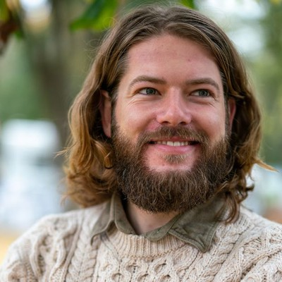]

 

.center.width-85[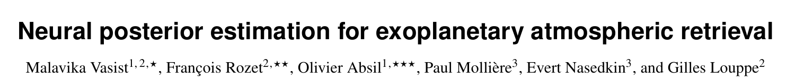]

.grid[
.kol-3-5[.center.width-90[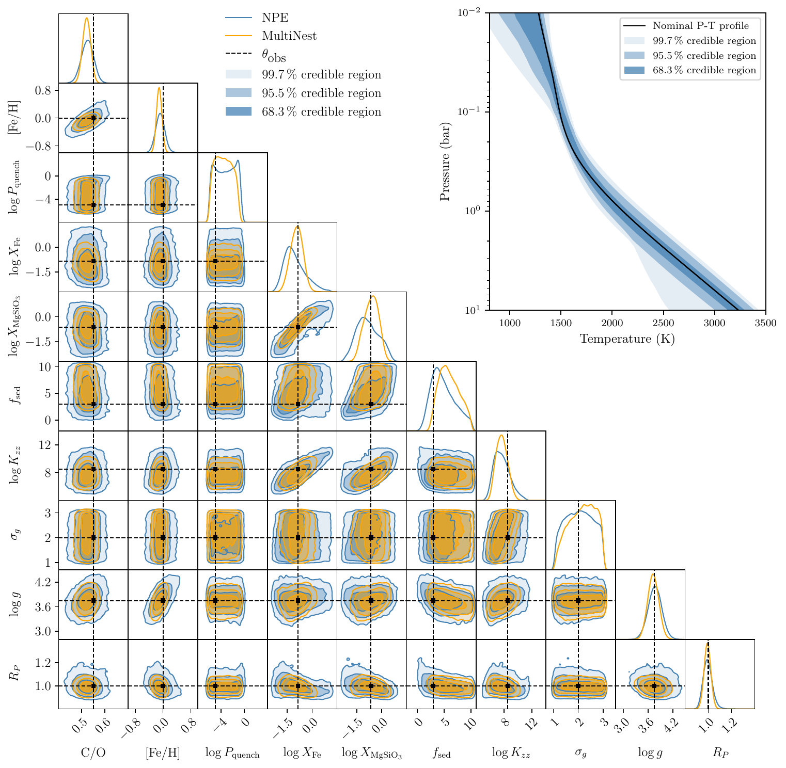]]
.kol-2-5[
.center.width-65[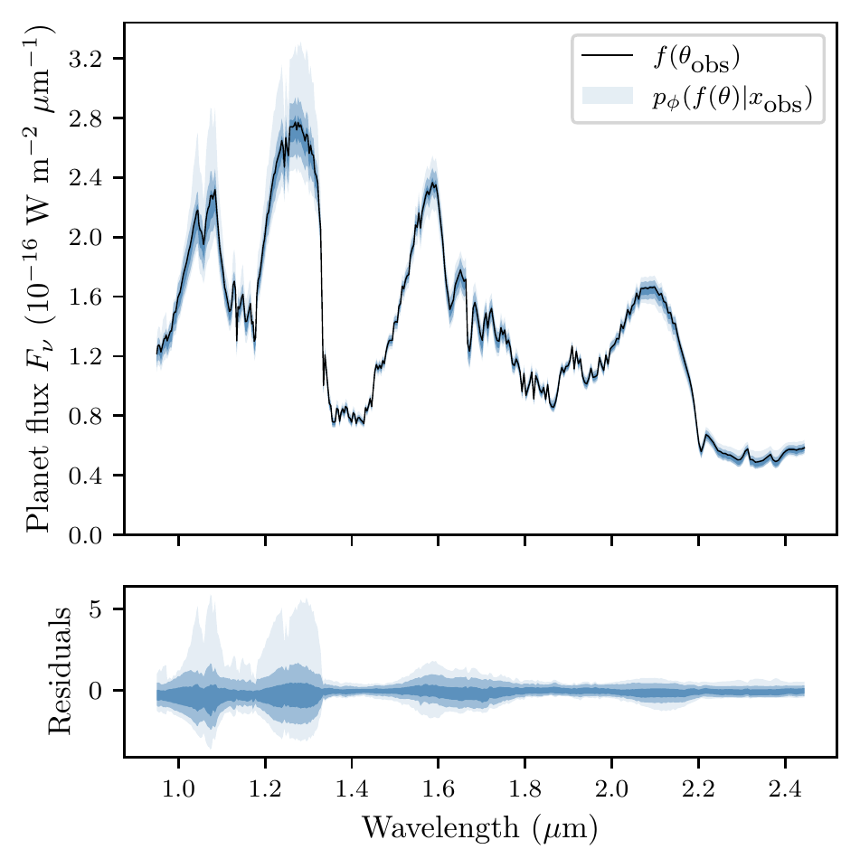]
.center.width-65[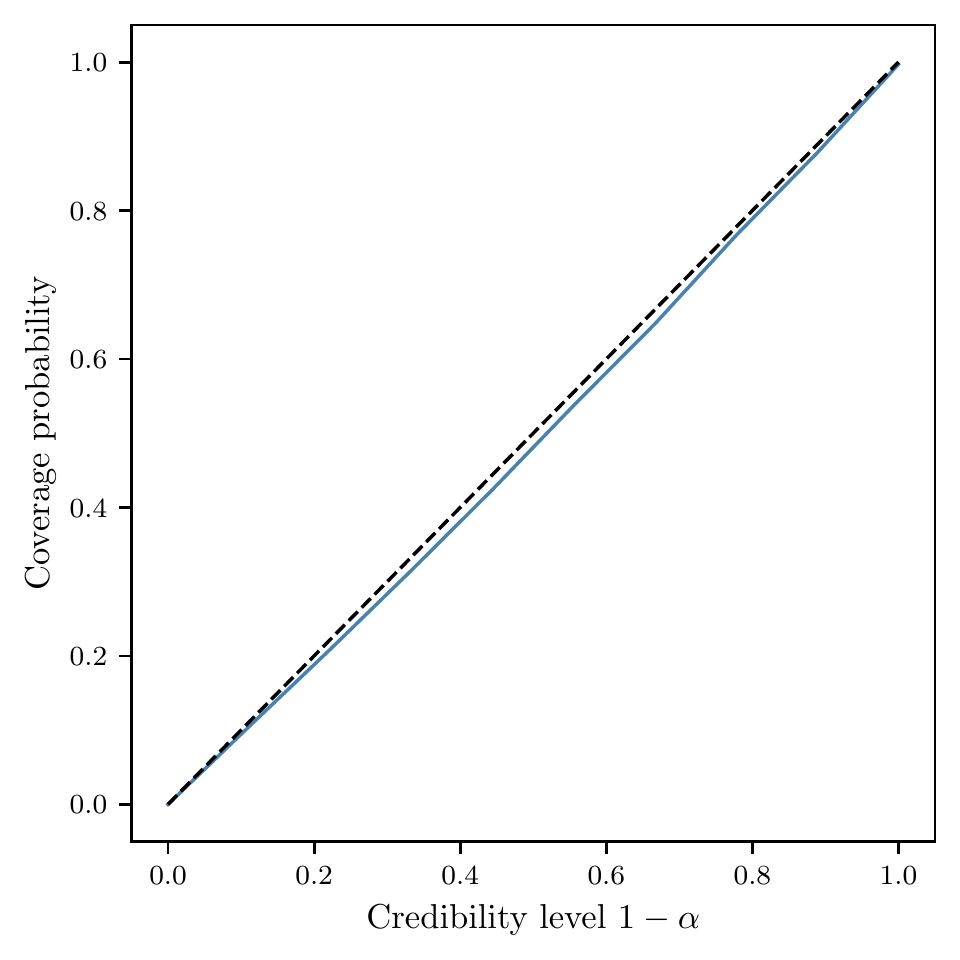]
]
]

.footnote[[Vasist et al](https://arxiv.org/abs/2301.06575), A&A 672, A147, 2023. Simulated benchmark spectrum.]

???

Everything we did on the toy problem was first shown to work with a realistic retrieval model in our 2023 paper with Malavika Vasist, François Rozet and Olivier Absil. It was a proof of concept: the first demonstration that neural posterior estimation is feasible for atmospheric retrieval. The spectrum is simulated, a benchmark modelled on HR 8799 e, so we know the truth.

The simulator is petitRADTRANS, with clouds, scattering and disequilibrium chemistry: sixteen parameters, as in the retrieval of HR 8799 e by Mollière and colleagues. Twelve million simulations, about seventeen thousand CPU hours, done once on a cluster. A flow, with an embedding network for the spectrum.

On the left, for the benchmark spectrum, NPE in blue agrees with MultiNest in orange. NPE takes seconds.

On the right, the same two checks as for the toy. At the top, the posterior predictive: spectra simulated from the posterior reproduce the observation, with residuals within the noise. At the bottom, expected coverage over many simulated spectra: on the diagonal, the posteriors are calibrated.

---

class: middle

.avatars[]

.center.width-90[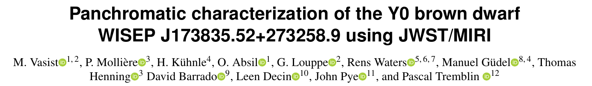]

.grid[
.kol-3-5[ .center.width-100[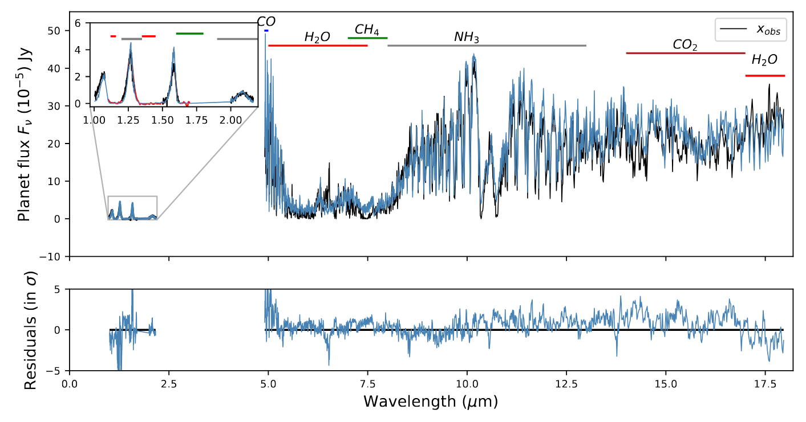]]
.kol-2-5[.center.width-100[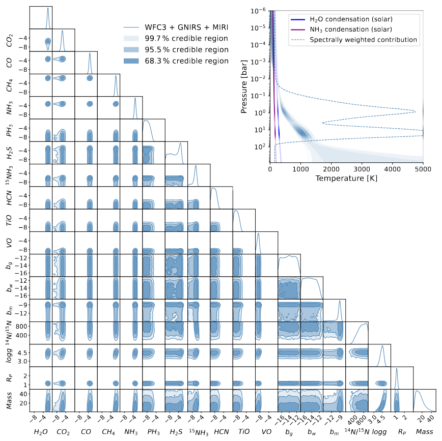]]
]

.footnote[[Vasist et al](https://arxiv.org/abs/2507.12264), A&A 703, A70, 2025. Real data: JWST/MIRI, HST/WFC3, Gemini/GNIRS.]

???

And on real data. WISE 1738 is a cold brown dwarf, about 400 kelvin, a good proxy for cold giant planets. We combined JWST/MIRI from 5 to 18 microns with near-infrared spectra from HST and Gemini.

On the left, the observed spectrum in black, and spectra from the posterior in blue. On the right, the posterior, with the temperature profile in the corner.

NPE confirms water, methane and ammonia, and finds carbon monoxide and carbon dioxide, which should not be there in equilibrium at this temperature: a sign of disequilibrium chemistry, that is, vertical mixing. And it constrains, for the first time, the isotopologue 15-ammonia. The posteriors were checked with coverage and other diagnostics, as before.

---

class: middle

## Beyond normalizing flows

NPE is agnostic to the choice of density estimator $q\_\phi(\theta | x)$.

.grid[
.kol-1-2[.center.width-100[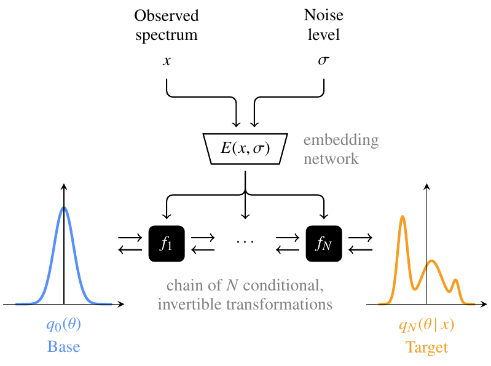]]
.kol-1-2[.center.width-100[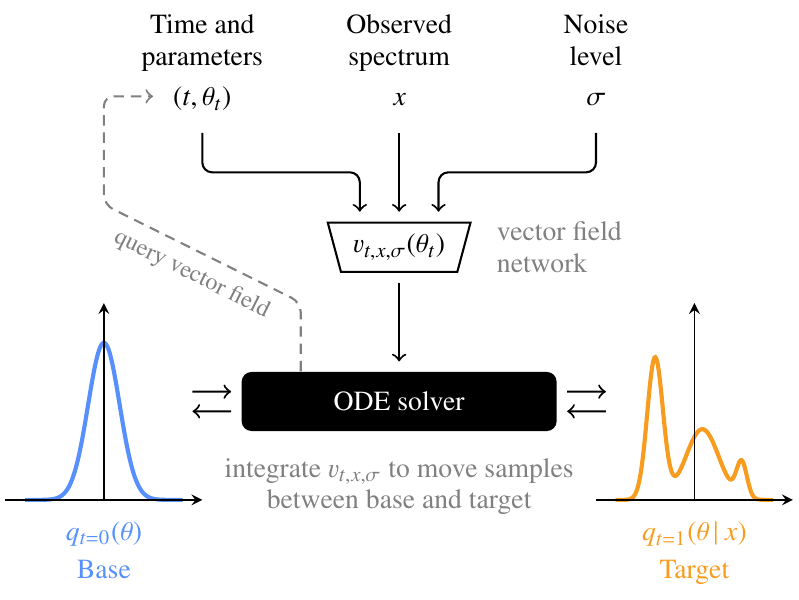]]
]
.grid[
.kol-1-2[.center[Discrete flow (NPE)]]
.kol-1-2[.center[Continuous flow (FMPE)]]
]

.footnote[Credits: [Gebhard et al](https://arxiv.org/abs/2410.21477), A&A 2025.]

???

NPE requires only a network that outputs a conditional density, and the flow we used is one choice among others. On the left, our choice, a chain of discrete invertible transformations. On the right, a continuous flow, in which a network defines a vector field and samples move from the Gaussian to the posterior by integrating an ODE. Both networks also take the noise level as input, so that a single network serves any signal-to-noise ratio. We return to this point.

---

class: middle

## Flow matching posterior estimation (FMPE)

.center[
<video poster="figures/fm-flow.png?v=2" muted loop autoplay playsinline class="anim" style="width: 80%;">
<source src="figures/videos/fm-flow.mp4?v=2" type="video/mp4">
</video>
]

 

Noise $\theta_0 \sim \mathcal{N}(0, I)$ flows along a vector field $v_\phi(\theta_t, t; x)$, from $t = 0$ to $1$.

.footnote[Animation: the exact flow-matching vector field towards a two-mode target.]

???

The animation shows a continuous flow: the samples move along a vector field that changes smoothly with time, from noise to a posterior with two modes. To sample, we start from noise and follow the vector field, by solving an ODE.

---

class: middle

As for discrete flows, the density is exact: map $\theta$ back to noise, from $t = 1$ to $0$, and sum along the way.
$$\begin{aligned} \log q\_\phi(\theta | x) &= \log \mathcal{N}(\theta\_0; 0, I) + \int\_1^0 \text{tr} \left( \frac{\partial v\_\phi(\theta\_t, t; x)}{\partial \theta\_t} \right) dt \\\\ &= \log \mathcal{N}(\theta\_0; 0, I) + \int\_1^0 \nabla \cdot v\_\phi(\theta\_t, t; x) \, dt. \end{aligned}$$

Train the vector field by regression, along straight paths $\theta\_t = (1-t)\, \theta\_0 + t\, \theta$:
$$\min\_\phi \; \mathbb{E}\_{t \sim \mathcal{U}(0,1),\; \theta\_0 \sim \mathcal{N}(0, I),\; (\theta, x) \sim p(\theta, x)} \left[ \left\Vert v\_\phi(\theta\_t, t; x) - (\theta - \theta\_0) \right\Vert^2 \right].$$

.footnote[[Dax et al](https://arxiv.org/abs/2305.17161), NeurIPS 2023.]

???

The density can still be computed exactly, which matters for what comes next. Compare with the discrete flow: there, we mapped the parameters to the noise, and corrected the Gaussian density by the log-determinant of the Jacobian of each transformation. Here, we do the same: we follow the flow backwards, from the parameters at time one to the noise at time zero, hence the integral from one to zero. In the limit of infinitely many infinitesimal steps, the sum becomes an integral, and the log-determinant becomes the trace of the Jacobian of the vector field. For a small step, the log-determinant of the identity plus a small Jacobian is its trace. With the triangular Jacobians of the discrete flow, the log-determinant was already a sum of diagonal terms: the trace is the same sum. The trace of the Jacobian is also the divergence of the vector field: how much the flow spreads samples apart, and so lowers their density.

How is the vector field trained? By flow matching. Take a sample of noise, and a pair of parameters and spectrum from the simulator. Draw the straight line between the noise and the parameters. At a random time along the line, the network should point along the line. It is a simple regression: no invertibility constraint on the network, which makes it more flexible and easier to scale.

---

class: middle

.avatars[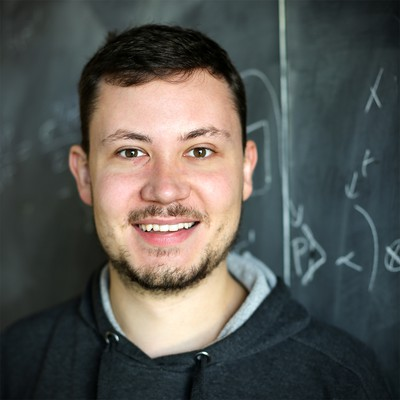]

 

.center.width-85[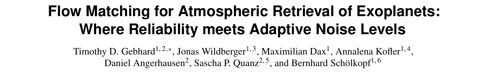]

.grid[
.kol-1-2[.center.width-90[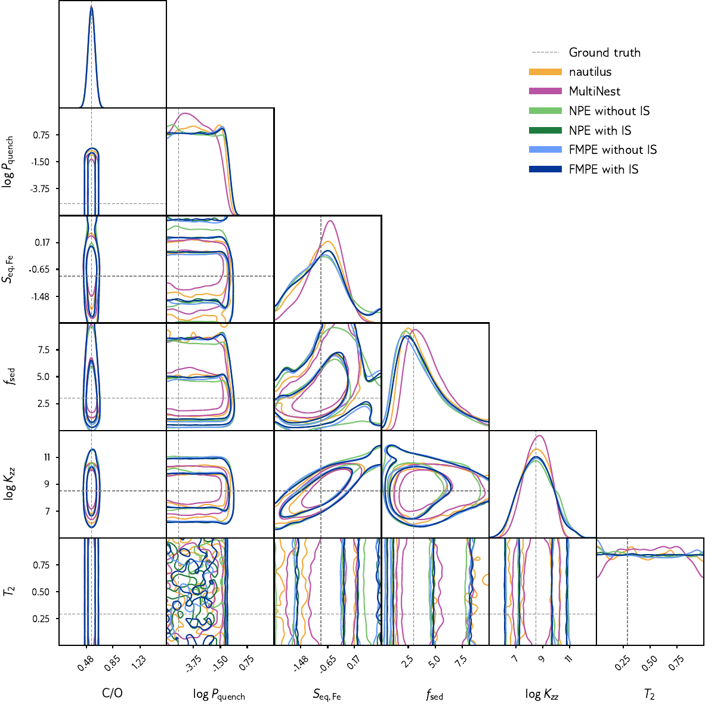]]
.kol-1-2[.center.width-90[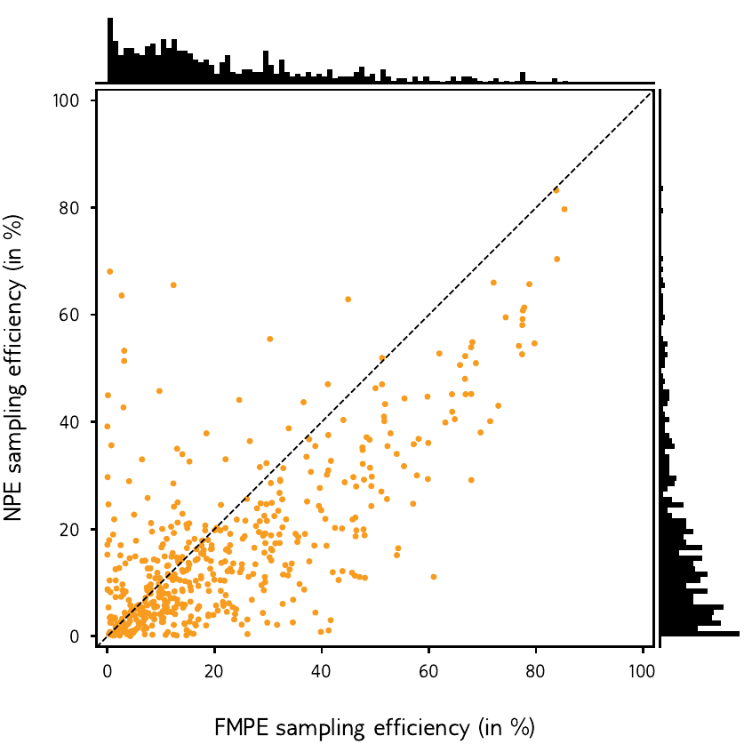]]
]

.footnote[[Gebhard et al](https://arxiv.org/abs/2410.21477), A&A 2025. Simulated benchmark of Vasist et al.]

???

This is the paper by Timothy Gebhard, Jonas Wildberger, Max, and colleagues. Same benchmark as before. Two ideas make it practical.

First, the network takes the noise level as input. One network covers any signal-to-noise ratio, instead of one network per instrument setting.

Second, importance sampling. Because the density of the network is exact, and the likelihood can be evaluated on this benchmark, samples from the network can be reweighted to correct its errors. The efficiency of the reweighting tells us when the network is wrong. And as a bonus, it gives the Bayesian evidence, which we need for model comparison.

On the left, FMPE and NPE, with and without importance sampling, against two nested samplers. They agree. On the right, the efficiency of importance sampling for many spectra, FMPE against NPE: FMPE is usually the better proposal.

---

class: middle

## Cheat code: importance sampling

When the likelihood can be evaluated, the network becomes a .bold[proposal]. Draw $\theta\_i \sim q\_\phi(\theta|x)$, then weight each sample by
$$w\_i = \frac{p(x | \theta\_i) \, p(\theta\_i)}{q\_\phi(\theta\_i | x)}.$$

.center[
<video poster="figures/toy-is.png" muted loop autoplay playsinline class="anim">
<source src="figures/videos/toy-is.mp4" type="video/mp4">
</video>
]

Weighted samples follow the .bold[exact] posterior. The efficiency $\varepsilon = (\sum\_i w\_i)^2 / (n \sum\_i w\_i^2)$ flags a poor network. The mean weight estimates the .bold[evidence] $p(x)$, needed for model comparison.

???

Here is a cheat code. If we can evaluate the likelihood, even if it is expensive, we can correct the network. We use it as a proposal: we draw samples from it, and give each a weight, the likelihood times the prior, divided by the density of the network. This is where the exact density of the flow matters.

Step one, samples from the network. Step two, the weights: samples where the network put too little mass get a large weight, and those where it put too much get a small one. Step three, we resample by weight. The result is the exact posterior: it lands on MCMC.

Two bonuses. The efficiency, here about 60%, says how good the proposal was: if it collapses, the network is wrong and we know it. And the average weight is the Bayesian evidence, which we need for model comparison.

The cost: a few thousand likelihood evaluations, not millions as in nested sampling.

---

class: middle

.center.width-70[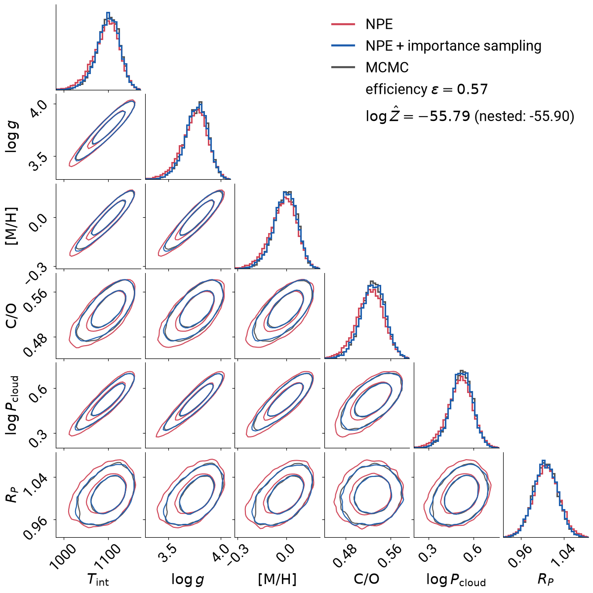]

.center[With importance sampling (blue), NPE matches MCMC (grey).]

???

All six parameters. In red, the network alone. In blue, after importance sampling. In grey, MCMC. Blue and grey coincide.

---

class: middle

## Model comparison

We compare two simulators, with and without a cloud deck. By eye, both fit.

.center.width-100[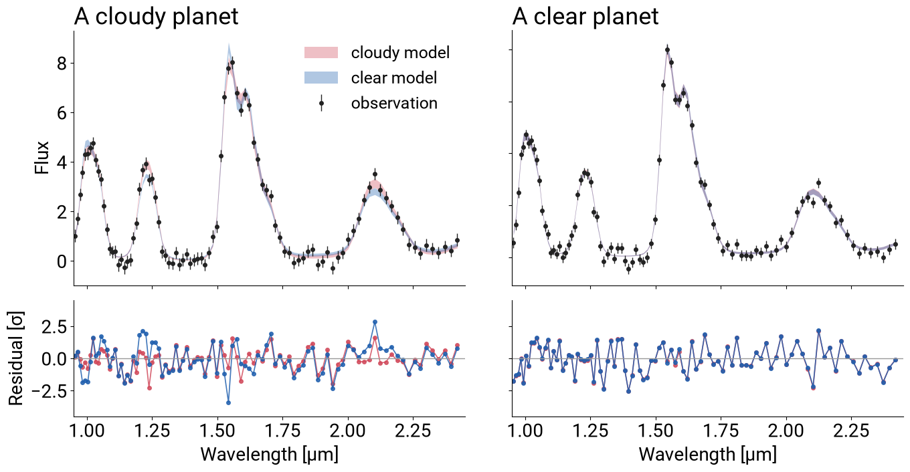]

???

The presence of clouds, or the detection of a molecule, are questions about models, not parameters. We consider two simulators, our toy with its cloud deck and six parameters, and the same toy without clouds and with five parameters.

For two planets, we show the posterior predictive of each model, that is, spectra simulated from its posterior. On the left, a cloudy planet. By eye, both models fit. The residuals below show that the clear model misses a few bins by two or three sigma, in the windows where clouds dim the light. Summed over the spectrum, its best fit is worse by a chi-square of about 47. The difference is hard to see, yet decisive in the evidence, with a log Bayes factor of 20.

On the right, a clear planet, which both models fit equally well. The cloudy model mimics a clear sky by placing its clouds deep. The small preference for the clear model, a log Bayes factor of about minus one, is the Occam penalty for the cloud parameter it does not need.

A posterior predictive check tells us that each model can fit. The evidence tells us which one explains the data better.

---

class: middle

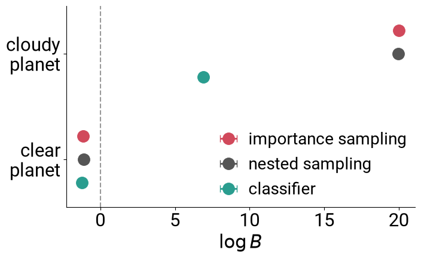

The .bold[Bayes factor] $B = p(x | \text{cloudy}) \,/\, p(x | \text{clear})$ compares the evidence of the two models.

Nested sampling$$p(x|M) \approx \sum_i p(x|\theta_i, M) \, \Delta X_i$$

Importance sampling$$p(x|M) \approx \frac{1}{n} \sum_i \frac{p(x|\theta_i, M) \, p(\theta_i|M)}{q_\phi(\theta_i|x)}, \quad \theta_i \sim q_\phi(\theta|x)$$

Classifier$$\log B \approx \log \frac{d_\psi(x)}{1 - d_\psi(x)}, \quad d_\psi(x) \approx p(\text{cloudy}|x)$$

.footnote[Classifier: [Radev et al](https://arxiv.org/abs/2004.10629), 2020. Model comparison without the evidence: MIRA, [Sharief et al](https://arxiv.org/abs/2605.02014), ICML 2026.]

???

The Bayes factor compares the evidences of the two models, that is, the probability of the observation under each model, averaged over its prior. We estimate the evidence in three ways, on the same two planets.

Nested sampling is the reference. It required from fifty thousand to a million likelihood calls for each spectrum and each model.

Importance sampling with the network of each model gives the same answer. The mean weight is the evidence, and the network only needs to be a good proposal.

A classifier requires no likelihood at all. We train it to tell which model simulated a given spectrum. Its output is the posterior probability of each model, and its log-odds are the Bayes factor. On the clear planet it agrees with the other two. On the cloudy planet it detects decisive evidence but saturates, since a classifier cannot resolve probabilities of one in a billion. The answer suffices for a decision, not for a precise value.

The cloudy planet shows overwhelming evidence for clouds, and the clear planet a mild preference for the simpler model.

---

class: black-slide, middle

.bg-video[<video autoplay muted loop playsinline poster="figures/exo-x-poster.jpg" src="figures/videos/exo-x.mp4" style="filter: brightness(0.55);"></video>]

.punch[
.punch-title[Summary]

Inference requires a simulator, not a likelihood.

A neural posterior estimator is trained once; it then gives the posterior of any spectrum in seconds.

Calibration tests the network; posterior predictive checks test the model.

An overdispersed posterior is safer than an overconfident one.

With a likelihood, importance sampling corrects the network and gives the evidence, for model comparison.
]

???

Five things to remember.

Inference requires a simulator, not a likelihood. The prior, the physics and the instrument make a simulator; inference only needs to run it. So make the simulator as realistic as you can, rather than as convenient as the sampler needs.

A neural posterior estimator is trained once; it then gives the posterior of any spectrum in seconds. Amortization also makes checks affordable that were not before.

Calibration tests the network. Posterior predictive checks test the model, and the evidence compares models. And if you have a likelihood, importance sampling makes the posterior exact.

An overdispersed posterior is safer than an overconfident one, which claims what the data do not support. And the network has only seen what the simulator can produce: outside of it, it will still answer, silently.

---

class: middle

## Reading list

.reading[
Reviews

- Dax et al, [An introduction to Bayesian and frequentist simulation-based inference with machine learning](https://arxiv.org/abs/2607.21702), 2026.
- Cranmer, Brehmer and Louppe, [The frontier of simulation-based inference](https://arxiv.org/abs/1911.01429), PNAS 2020.
- Deistler et al, [Simulation-based inference: a practical guide](https://arxiv.org/abs/2508.12939), 2025.
- Arruda et al, [Diffusion models in simulation-based inference: a tutorial review](https://arxiv.org/abs/2512.20685), TMLR 2026.

Simulation-based inference for exoplanets

- Márquez-Neila et al, [Supervised machine learning for analysing spectra [...]](https://arxiv.org/abs/1806.03944), Nature Astronomy 2018.
- Haldemann et al, [Exoplanet characterization using conditional invertible neural networks](https://arxiv.org/abs/2202.00027), A&A 2023.
- Vasist et al, [Neural posterior estimation for exoplanetary atmospheric retrieval](https://arxiv.org/abs/2301.06575), A&A 2023.
- Aubin et al, [Simulation-based inference for exoplanet atmospheric retrieval [...]](https://arxiv.org/abs/2309.09337), 2023.
- Ardévol Martínez et al, [FlopPITy: enabling self-consistent exoplanet atmospheric retrievals [...]](https://arxiv.org/abs/2401.04168), A&A 2024.
- Gebhard et al, [Flow matching for atmospheric retrieval of exoplanets](https://arxiv.org/abs/2410.21477), A&A 2025.
- Lueber et al, [Near-instantaneous atmospheric retrievals and model comparison with FASTER](https://arxiv.org/abs/2502.18045), ApJL 2025.
- Vasist et al, [Panchromatic characterization of the Y0 brown dwarf WISE 1738 using JWST/MIRI](https://arxiv.org/abs/2507.12264), A&A 2025.
]

???

If you want to go further. Our review with Max is the most direct follow-up to this tutorial. The PNAS paper is a short overview of the field. The practical guide covers the workflow in detail, and the tutorial review covers diffusion and flow-matching estimators. Then simulation-based inference for exoplanets, in order: the first retrievals trained on simulations, with random forests; interiors with invertible networks; neural posterior estimation for atmospheres; the Ariel data challenge; sequential NPE with self-consistent models; flow matching; neural ratio estimation with model comparison; and JWST data.

---

class: black-slide
background-image: url(figures/title-bg.jpg)
background-size: cover

.closing-end[The end.]

???

A prior, physics, an instrument: a simulator. We cannot evaluate the likelihood, but we can simulate it, and that is enough.

Thank you.
